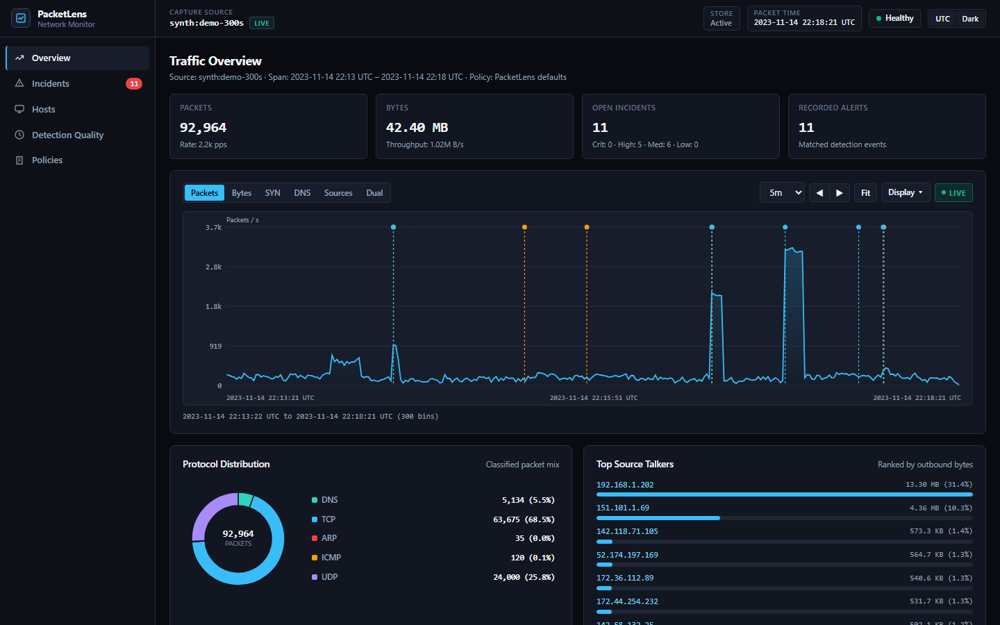
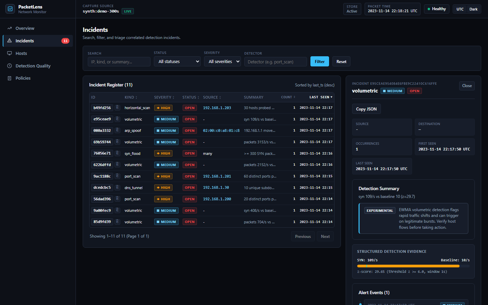
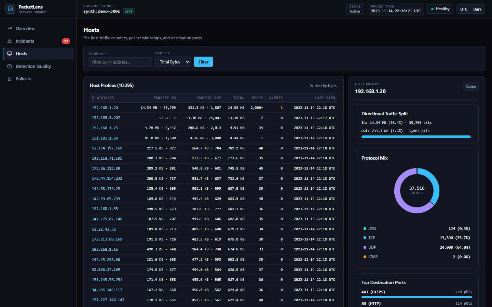

# PacketLens

**PacketLens v1.0.0** is a network traffic analyzer built from scratch in Python. Its core package uses only the Python standard library to parse PCAP and PCAPNG captures (as well as authorized Linux live interfaces), decode link/network/transport headers byte-by-byte, detect behavioral and volumetric anomalies, persist incidents and host profiles to SQLite, and serve a local operational dashboard and standalone HTML reports.

## Highlights

- **Zero-dependency core:** `packetlens` runs on Python 3.10+ with no third-party runtime packages.
- **PCAP + PCAPNG parsing:** Supports classic PCAP (v2.4, microsecond/nanosecond timestamps) and PCAPNG (`SHB`, `IDB`, `EPB`, `SPB` with `if_tsresol` resolution) over Ethernet (`1`) and Linux cooked (`113`) frames, including stacked 802.1Q/802.1ad QinQ VLAN tags and bounded IPv6 extension header traversal.
- **Signature & volume detection:** Built-in `port_scan`, `syn_flood`, `dns_tunnel`, `arp_spoof`, and `horizontal_scan` detectors plus an experimental EWMA z-score `volumetric` detector controlled by validated JSON policy rules.
- **Operational triage & reporting:** WAL-mode SQLite persistence with grouped incident lifecycles (`open` → `acknowledged` → `closed`), audit logs, host traffic/port inventories, retention pruning, backups, and CSP-hardened standalone HTML exports.
- **Local dashboard:** Loopback-bound HTTP UI with dark/light themes, real-time traffic timelines, incident evidence views, host profiles, policy inspection, and evaluation metrics.

## Dashboard

Replay a capture locally (prints a per-run bearer token for state-changing actions):

```bash
python -m packetlens serve --pcap demo.pcap --loop
```

### Traffic Overview


### Incident Triage & Evidence


### Host Inventory


## Quick start

Requires Python 3.10 or newer:

```bash
python -m pip install -e .
python -m unittest discover -s tests -v
```

Generate a synthetic capture, analyze it into SQLite, export an HTML report, and inspect it in the dashboard:

```bash
python -m packetlens generate demo.pcap
python -m packetlens analyze demo.pcap --db packetlens.db
python -m packetlens report --db packetlens.db --out report.html
python -m packetlens serve --pcap demo.pcap --loop
```

Analyze an existing `.pcap` or `.pcapng` capture directly:

```bash
python -m packetlens analyze capture.pcapng --db packetlens.db
python -m packetlens incidents list --db packetlens.db
```

## Architecture

```text
capture (PCAP / PCAPNG / Linux AF_PACKET)
  -> byte-level parser (Ethernet / Linux SLL / VLAN QinQ / IPv4 / IPv6 / TCP / UDP / ICMP / ARP / DNS)
  -> detectors & policy engine
  -> SQLite WAL store (incidents, alerts, hosts, minute stats, capture runs)
  -> HTTP dashboard & standalone HTML report
```

### Policy configuration

Detection rules, thresholds, cooldowns, allowlists, and `alert`/`log` actions are validated against [`packetlens/policies/default.json`](packetlens/policies/default.json):

```bash
python -m packetlens policy validate packetlens/policies/default.json
python -m packetlens policy show
```

### Store maintenance

```bash
python -m packetlens store backup --db packetlens.db --out packetlens-backup.db
python -m packetlens store prune --db packetlens.db --days 30
```

## Evaluation results

Headline results below are rendered from `results/*.json` via `python -m packetlens render-results` and verified by `tests/test_generated_docs.py`:

<!-- RESULTS:START -->
### Current evidence

| Experiment | Headline |
| --- | --- |
| Synthetic packet evaluation | 7/7 events detected; alert precision 0.909. |
| Throughput benchmark | Parse 395536 packets/s; pipeline 140644 packets/s. |
| Per-minute flow detectors | zscore_adaptive: P=0.522 [0.19, 0.833] (n=484), R=0.079 [0.02, 0.157] (n=484); zscore_frozen: P=0.623 [0.378, 0.8] (n=484), R=0.217 [0.102, 0.342] (n=484); isolation_forest: P=1 [1, 1] (n=484), R=0.171 [0.065, 0.288] (n=484); granite: P=0.714 [0.464, 0.9] (n=484), R=0.132 [0.056, 0.221] (n=484) |
| flowmodel_real.json | Bot Random Forest: P=0.6604 [0.41915, 0.804072] (n=130), R=0.2624 [0.115463, 0.410833] (n=130), F1=0.3755 [0.181544, 0.540465] (n=130). Exact duplicates: Bot 0.121439, BENIGN 0.077917; duplicate-free test P=0.5595, R=0.1604 (n=70431). |
| flowmodel_portscan.json | PortScan Random Forest: P=1 [1, 1] (n=36), R=0.9992 [0.996834, 0.99975] (n=36), F1=0.9996 [0.998415, 0.999875] (n=36). Exact duplicates: PortScan 0.989571, BENIGN 0.094423; duplicate-free test P=1.0, R=0.9204 (n=34755). |
| flowmodel_ddos.json | DDoS Random Forest: P=0.9997 [0.999048, 0.999886] (n=54), R=0.9988 [0.994816, 0.999952] (n=54), F1=0.9992 [0.997058, 0.999844] (n=54). Exact duplicates: DDoS 0.000121, BENIGN 0.043571; duplicate-free test P=0.9997, R=0.9988 (n=88158). |
<!-- RESULTS:END -->

## Offline ML research (`research/`)

The flow-level machine learning experiments (Isolation Forest, Random Forest, Granite Time Series) run offline on CIC-IDS2017 flow tables. They are not part of the live packet pipeline.

Offline research code lives in the top-level `research/` directory (`research/flows.py`, `research/flowmodel.py`, `research/ml.py`), keeping the packaged `packetlens` runtime free of ML dependencies. To run reproduction experiments from a repository checkout:

```bash
python -m pip install -e ".[ml]"
python -m packetlens reproduce --skip-real
python -m packetlens reproduce --data-dir cicids2017_traffic_label
```

`reproduce` performs a dry run unless `--write` is passed and skips cleanly when CIC-IDS2017 CSVs are absent. Obtain the dataset from the [CIC-IDS2017 dataset page](https://www.unb.ca/cic/datasets/ids-2017.html), place CSVs in `cicids2017_traffic_label/`, and cite Sharafaldin, Lashkari, and Ghorbani, "Toward Generating a New Intrusion Detection Dataset and Intrusion Traffic Characterization," ICISSP 2018.

Key experimental caveats recorded in `results/*.json`:
- **Duplicate contamination:** High headline scores on PortScan and DDoS splits are heavily inflated by exact duplicate feature rows between train and test partitions; duplicate-free checks are reported alongside every score.
- **Label/feature leakage:** Bot diagnostics show sensitivity to flow-window artifacts and source-IP distribution rather than generalizable traffic structure.
- **Granite context window:** Zero-shot Granite time-series evaluation scores only the single per-minute flow series after context warm-up.

## Security & limitations

- **Loopback-first HTTP server:** `packetlens serve` binds to `127.0.0.1:8080` by default without TLS and requires its startup bearer token for mutating API calls. Using `--allow-remote` exposes unencrypted HTTP and should only be done behind an authenticated TLS reverse proxy on a trusted network.
- **Untrusted capture inputs:** Packet payloads, addresses, DNS names, and alert details are treated as untrusted and escaped in both the dashboard and exported HTML reports (`Content-Security-Policy` enforced).
- **Platform & live capture:** Live interface capture (`packetlens live` / `packetlens serve --iface`) uses Linux `AF_PACKET` sockets and requires appropriate privileges. On Windows and macOS, PacketLens operates on offline PCAP/PCAPNG files and capture replay. Monitor only networks you own or are explicitly authorized to inspect.
- **Detection coverage:** Built-in signature rules target TCP SYN port scans, SYN floods, DNS tunneling patterns, ARP mapping changes, and horizontal scans. The `volumetric` EWMA detector is marked `experimental` in the default policy due to false alarms on bursty benign traffic.

## Development

```bash
python -m unittest discover -s tests -v
node --check packetlens/static/app.js
git -c core.whitespace=cr-at-eol diff --check
```

CI verifies the test suite across Python 3.10–3.13 without optional dependencies, in a `pandas`-only environment without `scikit-learn`, and with full `.[ml]` extras installed, alongside JS syntax checks, whitespace checks, CLI smoke checks, and a 5 MiB tracked-file limit.

To enable the local pre-push hook enforcing GitHub's 100 MiB blob check:

```bash
git config core.hooksPath .githooks
```

## Repository layout

```text
packetlens/                    Core zero-dependency packet analyzer, store, CLI, and web UI
  policies/default.json        Packaged default detection policy
  static/                      Dashboard HTML, CSS, and JavaScript
research/                      Offline CIC-IDS2017 ML experiments (not part of live pipeline)
results/                       Published evaluation JSONs and provenance metadata
scripts/                       Hugging Face PCAP validation and screenshot helpers
assets/                        Dashboard screenshots for README
tests/                         Unit, integration, reliability, security, and doc tests
```

## License

Released under the [MIT License](LICENSE).
