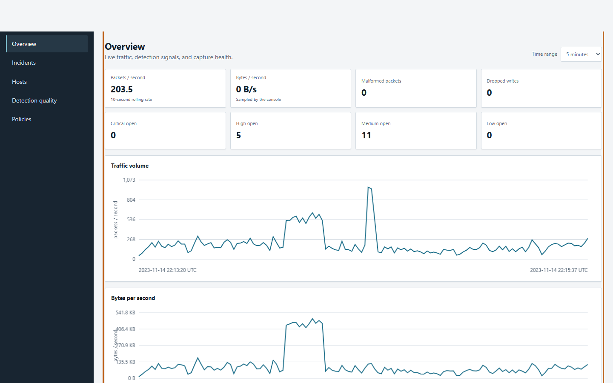
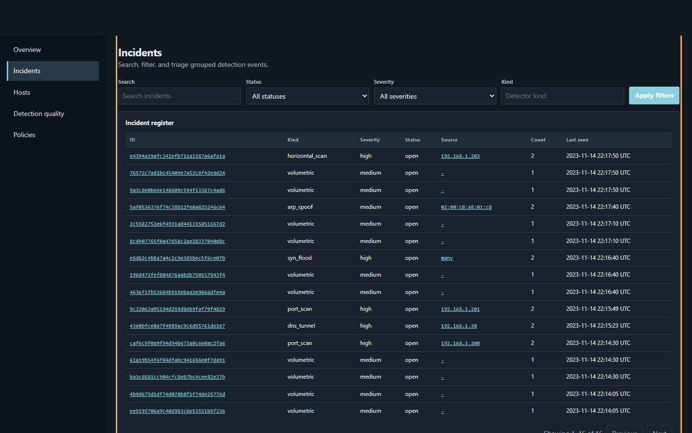

# PacketLens

PacketLens is a Python network-traffic analyzer for packet captures and authorized live monitoring. It decodes supported link and network protocols, detects selected network behaviors, and records alerts for review. Its local dashboard and HTML reporting tools make capture summaries, incidents, hosts, policies, and evaluation results accessible without a third-party runtime dependency.

## Quick start

Python 3.10 or newer:

```bash
python -m pip install -e .
python -m unittest discover -s tests -v
python -m packetlens generate demo.pcap
python -m packetlens analyze demo.pcap
python -m packetlens serve --pcap demo.pcap --loop
```

The core package uses only the Python standard library. The optional flow experiments require pandas, NumPy, and
scikit-learn:

```bash
python -m pip install -e ".[ml]"
python -m packetlens reproduce --skip-real
python -m packetlens reproduce --data-dir cicids2017_traffic_label
```

`reproduce` is a dry run unless `--write` is supplied. The flow commands skip cleanly when required data files are
missing. CIC-IDS2017 CSVs are not included; obtain them from the
[CIC-IDS2017 dataset page](https://www.unb.ca/cic/datasets/ids-2017.html) and place the files in
`cicids2017_traffic_label/`. Cite Sharafaldin, Lashkari, and Ghorbani, “Toward Generating a New Intrusion Detection
Dataset and Intrusion Traffic Characterization,” ICISSP 2018, when using the dataset.

## Architecture

```text
capture -> parser -> detectors/policy -> store -> dashboard/report
```

Captures can come from a pcap file or authorized Linux live capture. The parser decodes Ethernet and Linux cooked
frames; detectors evaluate packet-level and volume signals; policy controls enabled rules and alert/log actions;
SQLite stores incidents and summaries; the dashboard serves a local operations UI, while `packetlens report`
exports a standalone HTML report.

## Features and status

* **Packet analysis — available:** pcap read/write, Ethernet and Linux cooked link types, IPv4/IPv6, TCP, UDP, ICMP,
  ARP, and DNS question parsing.
* **Detection — available:** TCP port probing, SYN floods, DNS-tunnel-like queries, ARP mapping changes, horizontal
  scans, and per-second traffic-volume anomalies.
* **Policy — available:** validated JSON rules, enabled/disabled state, alert/log action, thresholds, cooldowns,
  and source/destination allowlists. The packaged default is
  [`packetlens/policies/default.json`](packetlens/policies/default.json); a unit test checks this reference and
  validates the file.
* **Persistence and review — available:** bounded SQLite storage, incident status workflow, host summaries,
  dashboard, and self-contained HTML reports.
* **Synthetic evaluation — available:** seeded labelled packet generation, detector evaluation, and throughput
  benchmark.
* **CIC-IDS2017 evaluation — offline and optional:** one-minute flow-series experiments and per-flow classifiers.
  Their scope and evidence limits are documented in the evaluation protocol and limitations.

Classic pcap captures with a partial record header or packet payload, or a captured packet length greater than the
original packet length or a nonzero global-header snaplen, are rejected with an error before packet data is read. A
global-header snaplen of zero imposes no captured-length bound on the reader. A captured length smaller than the
original length is valid when it is within snaplen (snap-truncated capture); an empty capture with a complete global
header is also valid.
Only global-header version 2.4 is supported; other major/minor versions are rejected before record reads. Timestamp
fractions at or above 1,000,000 in microsecond captures or 1,000,000,000 in nanosecond captures are rejected. For a
nonzero configured snaplen, `PcapWriter` rejects larger packet data rather than truncating it. Separately, the
PacketLens-specific `PcapWriter(snaplen=0)` behavior is to write zero to the global-header snaplen and accept packets
without truncating them. Pcapng is not supported.

The flow-level machine learning experiments (Isolation Forest, Random Forest, Granite Time Series) run offline on CIC-IDS2017 flow tables. They are not part of the live packet pipeline.

## Dashboard

Replay a capture locally:

```bash
python -m packetlens serve --pcap demo.pcap --loop
```

The server prints its generated access token at startup. The dashboard includes overview, incident, host, detection
quality, and policy views. Screenshots are included because the corresponding assets exist in `docs/screenshots/`.





## Generated evaluation results

The tables below are generated from `results/*.json` by `python -m packetlens render-results`. Do not edit the
generated section by hand; the test suite checks it against freshly rendered output. The full tables, run provenance,
and caveats are in [`docs/RESULTS.md`](docs/RESULTS.md).

<!-- RESULTS:START -->
### Current evidence

| Experiment | Headline |
| --- | --- |
| Synthetic packet evaluation | 7/7 events detected; alert precision 0.909. |
| Throughput benchmark | Parse 395536 packets/s; pipeline 140644 packets/s. |
| Per-minute flow detectors | zscore_adaptive: P=0.522 [0.19, 0.833] (n=484), R=0.079 [0.02, 0.157] (n=484); zscore_frozen: P=0.623 [0.378, 0.8] (n=484), R=0.217 [0.102, 0.342] (n=484); isolation_forest: P=1 [1, 1] (n=484), R=0.171 [0.065, 0.288] (n=484); granite: P=0.714 [0.464, 0.9] (n=484), R=0.132 [0.056, 0.221] (n=484) |
| flowmodel_real.json | Bot Random Forest: P=0.6604 [0.41915, 0.804072] (n=130), R=0.2624 [0.115463, 0.410833] (n=130), F1=0.3755 [0.181544, 0.540465] (n=130). Exact duplicates: Bot 0.121439, BENIGN 0.077917; duplicate-free test P=0.5595, R=0.1604 (n=70431). |
| flowmodel_portscan.json | PortScan Random Forest: P=1 [1, 1] (n=36), R=0.9992 [0.996834, 0.99975] (n=36), F1=0.9996 [0.998415, 0.999875] (n=36). Exact duplicates: PortScan 0.989571, BENIGN 0.094423; duplicate-free test P=1.0, R=0.9204 (n=34755). |
| flowmodel_ddos.json | DDoS Random Forest: P=0.9997 [0.999048, 0.999886] (n=54), R=0.9988 [0.994816, 0.999952] (n=54), F1=0.9992 [0.997058, 0.999844] (n=54). Exact duplicates: DDoS 0.000121, BENIGN 0.043571; duplicate-free test P=0.9997, R=0.9988 (n=88158). |
<!-- RESULTS:END -->

The generated PortScan and DDoS rows place per-class exact-duplicate rates and duplicate-free test precision/recall
beside the near-perfect headline scores. Those results should not be read without their duplicate checks.

Granite was scored on the single per-minute `flows` series while the other methods use six features. The cleaner
held-out-machine Bot diagnostic retained recall of 0.96, consistent with the label-window audit; this is not proof
that the labels are valid or that the model generalizes.

See the [evaluation protocol](docs/EVALUATION_PROTOCOL.md) for tasks, splits, false-alarm budgets, label audits, and
bootstrap intervals, and [limitations](docs/LIMITATIONS.md) for evidence boundaries.

## Security and authorized use

* The dashboard binds to `127.0.0.1` by default. Its per-run token is printed to the terminal and is required for
  incident status changes. Binding to a non-loopback address exposes captured data; use a trusted network and
  protect the token. The built-in HTTP server does not provide TLS.
* Network addresses, DNS names, packet contents, and incident details can be attacker-controlled. Treat displayed
  and exported traffic data as untrusted; avoid sharing captures or reports that contain sensitive information.
* Live capture requires Linux `AF_PACKET` and suitable privileges. Capture only networks and devices you own or are
  explicitly authorized to monitor, and follow applicable privacy and interception laws.

## Development

Run the tests:

```bash
python -m unittest discover -s tests -v
node --check packetlens/static/app.js
```

CI runs the test suite on Python 3.10 through 3.13 without optional ML dependencies and runs an additional
pandas/scikit-learn-enabled test job. Granite is not part of CI. CI also lists the ten largest tracked files and
fails if any exceeds 5 MB.

To enable the repository pre-push check for GitHub's 100 MiB file limit:

```bash
git config core.hooksPath .githooks
```

## Repository layout

```text
packetlens/pcap.py             pcap reader and writer
packetlens/parsers.py          byte-level protocol decoders
packetlens/detectors.py        packet-level detectors
packetlens/timeseries.py       per-second bins and EWMA volume detector
packetlens/policy.py           JSON policy loading and validation
packetlens/engine.py           packet processing and detector orchestration
packetlens/store.py            SQLite incidents, hosts, and capture summaries
packetlens/dashboard.py        local HTTP API and dashboard server
packetlens/report.py           standalone HTML report generation
packetlens/flows.py            offline per-minute CIC-IDS2017 experiments
packetlens/flowmodel.py        offline per-flow CIC-IDS2017 experiments
packetlens/stats.py            standard-library block bootstrap intervals
packetlens/reproduce.py        reproducible evaluation orchestration
packetlens/render_results.py   generated results documentation
packetlens/static/             dashboard HTML, JavaScript, and CSS
packetlens/policies/           packaged default policy
results/                       evaluation JSON and run provenance
docs/                          protocol, limitations, results, screenshots
tests/                         unit and integration tests
```
